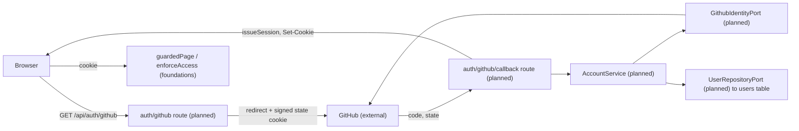

# Accounts and roles: GitHub and e-mail sign-in, role guards (E01, #29)

> Prototype: `prototypes/konta-i-role/`

> Status: draft for review, revised after the architectural review of 2026-10-21. Stories: #36 (S01 GitHub sign-in), #37 (S02 e-mail and password), #38 (S03 role guards, operator role).
> Depends on `platform-foundations.md` (access policy, page wrappers, tokens, role shell, rate limiter, mailer, form layer, test kit), a standing document that owns the shared mechanisms. The two specs refer to each other by step name, not number. This is the shared auth spec the three stories name as owed before implementation; each story keeps its own acceptance criteria in its issue.

## 📝 TLDR

Nobody can be identified in DevMentor today: the session helpers exist, but no cookie is issued, there is no `users` table, and `POST /api/mentors` and `/admin/mentors` are public. This spec (future behavior) delivers sign-in with GitHub first and e-mail plus password as the fallback (the password account is created when the user confirms an e-mail link, so no unverified account ever exists), one role per account (mentee, mentor, operator), a home screen per role, an operator role held only by the two founders, and the closing of every public write surface, built on the foundations spec.

## 📝 Problem Statement

- Who: mentees (developers with an urgent problem), invited mentors, and the operator (the two founders, D19). Interviews: a developer blocked before a release shipped a workaround (`research/2026-08-20-interview-working-dev.md`); a mentor says "my GitHub is my profile" (`research/2026-08-22-interview-mentor.md`); a fintech developer wants help "in twenty minutes, not create an account, verify the e-mail, then wait" (`research/2026-09-01-interview-backend-dev-fintech.md`). Sign-in friction is therefore itself a risk, and GitHub comes first.
- Code today: `core/src/http/auth.ts` signs and verifies a session JWT; nothing issues the `devmentor_session` cookie; the only migration creates `mentors`; no `auth` concept folder exists; `/api/mentors` GET and POST and `/admin/mentors` are public (the "known gap" in `AGENTS.md`).
- Rules (brief): D07/R06 GitHub first with e-mail fallback; D31/R23 exactly one role per account; D19/R18 the operator is the two founders and acts by hand where no story exists; R07/D08 mentors join by invitation only.

## ✅ Decisions

| Id | Decision | Source |
|---|---|---|
| Q1, Q2, Q9 | See the foundations spec. | user |
| Q3 | The role is `mentee` (brief Q22 closed; no code uses `student`). | user, recommended |
| Q7 | Sessions stay stateless 24 h JWTs; no server-side revocation. A role change reissues the cookie; removing an operator e-mail applies at next sign-in; rotating `JWT_SECRET` revokes everyone. | user, recommended |
| Q8 | Registration by e-mail creates the account only when the user confirms the e-mail link and sets a password; there is no unverified account, no resend route and no replacement transaction. Story #37's criteria are reworded accordingly. | user, recommended |

## 📝 Proposed Solution

Four pull requests on the foundations primitives:

1. **S01a, identity core (backend):** `users` table, session issuance, GitHub OAuth through a port, the routes, the test kit core. Its pull request says "Part of #36": its error redirects point at pages that arrive in S01b.
2. **S01b, sign-in and role homes (pages):** the sign-in page (a GitHub link and a static note, no form yet), `/home`, `/mentor`, the page wrappers, `RoleShell`, sign-out. Closes #36.
3. **S02, e-mail and password:** registration link, confirmation, login, rate limiting, public forms; it edits the S01b sign-in page, so it depends on S01b.
4. **S03, roles and guards:** operator derivation, `access` on the existing surfaces, the operator shell, public write surfaces closed.

Alternatives that lost: a server-side `sessions` table (instant revocation, but a read per request and a table the standards do not ask for; reopen if the founders need it, Q7); storing `operator` in `users.role` (it would be an assignable value, and R18 says there is no tool to assign it); combined roles per account (rejected by D31); **password at registration with an unverified row** (the first draft): it needed a resend route, a token lifetime, a transaction to replace unverified rows, and it left a pre-hijack path (an attacker registers a victim's address with a known password and the victim's verification click signs them in to the attacker's account) and a link a mail scanner could burn. Q8 removes all of it.

## 📝 Research

From general knowledge, not re-fetched in this run; direction, not evidence:

- Auth.js ships e-mail account linking off because linking on an unverified address is a takeover path. Adopted here: GitHub is linked to an existing account only through the verified primary e-mail, and only when that account has no `github_id` yet.
- GitHub OAuth web flow: authorization code with a `state` value, e-mail from `GET /user/emails` (the `/user` e-mail can be null or unverified; the primary verified entry is read). The scope is `user:email` only (the public profile from `GET /user` needs none). The `state` query value is a random nonce; the state cookie carries a purpose-tagged signed value that includes the same nonce and a sanitised `returnTo`; the callback compares the two in constant time, so a signed cookie alone is not mistaken for CSRF protection. The cookie is `HttpOnly`, `Secure` in production, `SameSite=Lax`, `Path=/api/auth`, expires after 10 minutes. The callback validates the configured redirect URI and client before exchanging the code. PKCE is not required for the confidential server-side client in 1.0; this is an explicit trade-off.
- Mentor marketplaces (Codementor, MentorCruise) offer social sign-in; not re-checked here.
- Next.js 16 guide (bundled docs): guard in each page; `proxy.ts` only as an optimistic redirect.

## 📝 Architecture

New concept folders, created with their first file: `auth` (entities, repositories, services, validators, routes).

Takeaway: every sign-in path ends in the same `issueSession(user)`, so the cookie contract does not change per provider, and every guarded request goes through the foundations `enforceAccess`.

Components:

- `core/src/services/auth/account.service.ts` (`AccountService`): `findByEmail`, `findOrCreateFromGithub`, `createPasswordAccount` (S02), `findForLogin` (S02), `grantRole(userId, role: StoredRole)`. GitHub linking is `UserRepositoryPort.linkGithub(userId, githubId): Promise<boolean>`, a conditional `UPDATE ... WHERE id = ? AND github_id IS NULL` (the once-only shape of the foundations spec); `false` falls through to the refusal. The per-address registration cooldown lives in the route through `enforceRateLimit`, not in a service.
- `core/src/services/auth/password-auth.service.ts` (`PasswordAuthService`, S02): `requestRegistration`, `confirmRegistration`, `authenticate`; it uses `AccountService` (the methods above), the password hasher, the purpose-token helper and the mailer, and nothing else.
- `core/src/services/auth/user-repository.port.ts`, `user.types.ts`; implementation `db/src/repositories/auth/user.repository.ts` (maps 23505 to `ConflictError`; the entity is referenced by name, per the lesson on duplicate package copies).
- `core/src/services/auth/session-issuer.ts`: `effectiveRole(user, operatorEmails)` and `issueSession(user)` returning the token and the cookie string. One place decides the role in the cookie. The cookie is `Secure` when `NODE_ENV=production` unless the test-only `isInsecureHttpAllowed()` is true (foundations Config).
- `core/src/services/auth/github-identity.port.ts` and `adapters/github-identity.adapter.ts` (authorize URL, code exchange, `/user`, `/user/emails`; base URLs from config).
- `core/src/http/tokens.ts` (foundations): `signPurposeToken`/`verifyPurposeToken` back `oauth-state` and the registration link; `core/src/services/auth/password-hasher.ts` (bcryptjs, a hasher, registered as `passwordHasher`).
- Registered in `app/src/server/container.ts`: `userRepository`, `accountService`, `githubIdentity`, `passwordHasher`, `passwordAuthService` (one explicit line each; `rateLimiter` and `mailer` come from the foundations spec).
- Cross-system effects: E02-S01 (invitation accept) calls `grantRole` and `issueSession` to reissue the cookie; E03 onwards take `actor: Session` from `enforceAccess`. No event is emitted (no emitter exists; the catalogue assigns it to E03-S03). E01 needs no transaction: sign-in is one insert protected by unique constraints (the transaction recipe is built by E02-S01).

### Role derivation

Stored role is `mentee` or `mentor` (a database check constraint). `operator` is never stored: `effectiveRole` returns `operator` only when the account's e-mail is in `OPERATOR_EMAILS` (every account has a verified e-mail by construction) and the stored role is not `mentor` (D31). An account on the list whose stored role is mentor signs in as mentor; the founder uses another address for the operator account. `grantRole` in turn refuses to grant `mentor` to an account whose e-mail is on the list. Two types: `Role = "mentee" | "mentor" | "operator"` for the session and guards, and `StoredRole = Exclude<Role, "operator">` for the column, the repository and `grantRole`, so the type system forbids storing `operator`. Because sessions are stateless (Q7), a mentor's older cookie on another device can still say `mentee` for up to 24 hours: services that move money or check ownership read the role from the user row, not from the cookie.

### Guard layers

1. Route: `access` declared on every `apiHandler` and `makeCrudRoute` (foundations), roles equality only.
2. Page: `guardedPage({ path, access }, render)` or `publicPage(...)` on each page (foundations), redirect before any data fetch.
3. Record: services take `actor`, query by `actor.userId` and call `assertOwns` on every mutation; a booking has two parties and uses `resolveParty` (foundations, built by E02-S02). A client-supplied id never identifies the caller.

Role homes: mentee `/home`, mentor `/mentor`, operator `/admin/mentors`; `homeFor(role)` (foundations) is the single mapping used by sign-in redirects and by the wrong-role redirect.

## 📝 Data Model

One new entity, `User` (table `users`, snake_case, UUID id, generated migrations, `up` and `down` tested through the foundations migration helper). Two migrations: S01a creates the table, S02 adds the password column (additive).

| Column | Type | Notes |
|---|---|---|
| `id` | uuid pk, `gen_random_uuid()` | |
| `email` | text, unique, stored lower-cased | login identifier |
| `email_verified_at` | timestamptz, not null | set from GitHub's verified primary e-mail or when the registration link is confirmed; there is no unverified account |
| `display_name` | text | |
| `role` | text, default `mentee`, check in (`mentee`, `mentor`) | `operator` is derived, never stored |
| `github_id` | text unique null | GitHub ids are numeric; text avoids precision loss |
| `github_login`, `avatar_url` | text null | display only |
| `password_hash` | text null (S02) | bcrypt, cost 12 |
| `created_at`, `updated_at` | timestamptz | |

Sensitive data: `password_hash` and tokens never appear in API responses, logs, client-side application state, or plaintext database columns (the DTO that leaves the service is an allowlist without them). The registration token is passed only to the mail adapter as part of the message body; access tokens remain inside the GitHub adapter boundary. The entity is independent of the existing `Mentor` entity; E02-S01 links an invited user to a mentor page later, so no relation is drawn here and no graph is generated.

## 📝 API Contracts

All routes use `apiHandler` and `force-dynamic`. JSON routes use the envelope `{ ok, data | error }`. The two browser-navigation routes (`/api/auth/github` and its callback) pass `apiHandler`'s `navigation` option, which turns a typed error into a redirect to `/sign-in?error=<code>` with a plain message, never raw JSON; no route writes its own `try/catch`.

| Route | Method | Access | Behavior |
|---|---|---|---|
| `/api/auth/github` | GET | public | Sets the signed state cookie (purpose `oauth-state`, nonce, 10 min, sanitised `returnTo`), redirects to GitHub with the nonce as `state`. Missing GitHub variables redirect to `/sign-in?error=unavailable`. |
| `/api/auth/github/callback` | GET | public | `error=access_denied` redirects to `/sign-in?cancelled=1`, creates nothing. Missing or mismatched `state` redirects to `/sign-in?error=state`. No verified e-mail redirects to `/sign-in?error=no-verified-email`. A verified e-mail whose account already has a different `github_id` redirects to `/sign-in?error=unavailable` (no takeover, no disclosure). Success: find or create, `issueSession`, `Set-Cookie`, redirect to `returnTo` or `homeFor(role)`. |
| `/api/auth/register` | POST | public, rate limited | `{ email, displayName, returnTo? }`; always answers "check your e-mail", whatever the address. A new address gets a mail with a link to `/register/confirm?token=` (purpose `register`, claims e-mail, display name and `returnTo`, lifetime `REGISTRATION_TOKEN_TTL` of 24 hours, a named constant); an address that already has an account gets a mail saying so and how to sign in (GitHub when the account has a `github_id`). Both paths do the same work (one token signature, one mail send) so timing does not tell them apart. Nothing is stored. A per-address cooldown (at most 3 mails per address per hour, independent of the client IP) stops mail abuse without changing the response. Registering again is the resend. |
| `/api/auth/register/confirm` | POST | public, rate limited | `{ token, password }`; verifies the token, hashes the password and creates the account verified (`email_verified_at = now`), issues the session and returns `{ redirectTo }` computed server-side (`safeReturnTo` or `homeFor(role)`). A token for an address that now has an account (a second use, or a race) creates nothing, issues nothing and answers a generic "this link was already used, sign in"; the unique `email` constraint makes exactly one request win. |
| `/api/auth/login` | POST | public, rate limited | `{ email, password, returnTo? }`; unknown e-mail and wrong password give the same generic `UnauthorizedError("Invalid credentials")` and equal work (a dummy bcrypt comparison); a GitHub-only account (no `password_hash`) gets the same answer; sets the cookie only on success; returns `{ redirectTo }` computed from a valid `returnTo` or `homeFor(role)`. The sign-in page passes the `returnTo` it received; an invalid `returnTo` in the page's query is ignored, not rejected. |
| `/api/auth/logout` | POST | public (CSRF header required), idempotent | Always sends the cleared cookie, so a stale, expired or role-invalid cookie is cleared too. |

The page `/register/confirm?token=` (GET) only renders the password form and changes nothing, so a mail scanner that fetches the link burns nothing; it gets `Referrer-Policy: no-referrer` and `Cache-Control: no-store` from `headers()` in `next.config.ts` (foundations, Response headers; the same headers cover `/sign-in` and the guarded areas).

Validation (Zod, in `core/src/validators/auth/`, exported also through `@devmentor/core/validators`): `register.schema.ts` (`email`; `displayName` of 1 to 80 characters with no control characters, newlines or URLs, because it is rendered in a mail the other person receives; `returnTo` optional), `confirm.schema.ts` (`token`, `password` of at least 12 characters and at most 72 UTF-8 bytes because bcrypt ignores the rest), `login.schema.ts` (`email`, `password`, `returnTo` optional). `safeReturnTo(value, appUrl)` rejects any control character (browsers strip tab, CR and LF), resolves the value with `new URL(value, appUrl)`, requires the same origin and a path that is not `/sign-in`, `/register*` or `/api/*` (no loops); an invalid value is rejected, never silently rewritten. `returnTo` travels inside the signed purpose tokens, never as an unsigned query parameter next to them. The `state`, registration and session tokens are separate purposes of the same secret: `verifySession` rejects any token carrying a `purpose` claim and `verifyPurposeToken` rejects a session token.

Cookie: existing name, HS256 and 24 h. `Secure` when `NODE_ENV=production`; the integration harness sets the test-only `ALLOW_INSECURE_HTTP=true` because it serves plain http (foundations Config).

Existing surface changes in S03 (breaking for anonymous callers, listed in the PR body): `GET` and `POST /api/mentors` become `access: { roles: ["operator"] }`.

## 📝 UI/UX

Only the unique parts.

- Style boundary (foundations Q9): all of these pages are Tailwind (`PublicForm`), including `/home` and `/mentor`; shadcn appears only on the operator and admin pages.
- `/sign-in` (Tailwind, `PublicForm`): GitHub button first (a real link, navigation not `fetch`), e-mail form second (D07). Distinct, plain messages for `cancelled=1`, `error=state`, `error=no-verified-email`, `error=unavailable`; the registration message never reveals whether an address has an account; one generic message for a failed password sign-in; a "check your e-mail" state after registering. A signed-in visitor opening `/sign-in` or `/register` is redirected to their home. The e-mail fallback is disabled with a note until S02 lands, so S01b ships a working page.
- `/register` (S02): e-mail and display name, then "check your e-mail". `/register/confirm` (S02): password form. `/home` (mentee), `/mentor` (mentor), each in `RoleShell` with sign-out and links only to their own screens (E01-S03). No link, route or copy anywhere offers "become a mentor" (R07).
- Sign-out: a button in `RoleShell` calls `POST /api/auth/logout` through `apiCall`, then navigates to `/sign-in`. A 401 from a signed-in screen redirects to `/sign-in?returnTo=`, but the login, register and confirm calls use `onUnauthorized: "ignore"` so a failed login renders its generic message instead of reloading the page (foundations Client contract).
- Accessibility: labelled inputs, errors in `role="alert"`, focus order GitHub then form.
- States: loading (submit locked), error (generic or specific as above), success redirect. No empty state exists yet.
- Route groups `(auth)`, `(mentee)`, `(mentor)`; the engineering standards' sample `(student)` becomes `(mentee)` (edit listed in foundations A3).

### Screen acceptance criteria from `lekcja-07/mapa-ekranow.md`

These criteria use the map's stable screen ids. They describe the E01 product behavior; `s09` and `s10` are explicitly prototype-only service simulations. An item marked out of scope is a recorded decision, not a missing feature.

| Screen | Acceptance criterion / recorded decision |
|---|---|
| [s01] | GitHub is the first sign-in action and is a real navigation link; the e-mail form follows it when S02 is enabled (and is disabled with a note in S01b). Loading disables submission; validation labels each field and focuses the first invalid field. Cancellation, invalid state, missing verified e-mail, unavailable GitHub, expired session and rate limit show the map's specified messages, including “Your session expired. Sign in to continue.”, “We couldn't sign you in with GitHub. Try again or use your e-mail.” and “Too many attempts. Try again in N minutes.” derived from `Retry-After`. Failed e-mail sign-in always shows the same generic error plus “or sign in with GitHub”, whether the address exists or not. The forgot-password note reads “Forgot your password? Password reset isn't available yet — sign in with GitHub or contact the DevMentor team.” and points to `support@devmentor.test` as a replaceable placeholder. A registration request ends in the same confirmation response for new and existing addresses. After logout there is no success notice. The page title is “DevMentor”; no “Mentora” product copy is used. |
| [s02] | Registration collects e-mail and display name, validates the schema, and submits to the confirmation state. Existing-account requests look identical to new-account requests; mail delivery failures and rate limits preserve entered values and show “Too many attempts. Try again in N minutes.” based on `Retry-After`. Invited users are carried by a safe `returnTo` only: this screen does not advertise mentor onboarding. No terms link or consent checkbox is shown. |
| [s03] | Successful registration shows a separate “check your e-mail” state; an authenticated visitor is redirected to their role home. Re-registering can resend a message, but after the third message in one hour the same response is shown and no further message is sent. The screen says “Didn't get it? Register again.” |
| [s04] | GET renders the password form without consuming the link. A valid confirmation creates one verified account, issues a session and redirects only to a safe `returnTo` or the role home. Invalid, expired, changed, already-used and missing tokens show the defined recovery state (“register again” for missing/expired/tampered; “sign in” for already used); rate limits use the same `Retry-After` message and preserve values. An authenticated visitor is redirected home. The address carried by the token is displayed above the password field. |
| [s05] | Only a mentee can see `/home`; anonymous access redirects to sign-in with `returnTo`, and another role is silently redirected to its own home before any protected content renders. The shell shows the account name (GitHub login fallback), “Mentee”, sign-out and an empty navigation menu; the page has one neutral welcome card, with no separate first-login greeting. “Mentee” is the displayed role; closing brief Q22 remains a separate brief task. A stale mentee cookie remains unannounced until its 24-hour expiry. There is no mentor-join copy. |
| [s06] | Only a mentor can see `/mentor`; other roles are silently redirected to their own home before protected content renders. The shell shows the account name, “Mentor”, sign-out and an empty navigation menu; the page has one neutral welcome card. An account whose stored role is mentor stays a mentor even if its e-mail is on the operator list, without an explanatory banner. |
| [s07] | Only an operator can view `/admin/mentors` or call the mentor list/create API: anonymous API requests return 401, mentee/mentor requests return 403, and operator requests return 200 for GET or 201 for POST. Preserve the existing mentor list and add form in this iteration. Anonymous page access redirects to sign-in; other roles are denied and sent to their own home. Loading, empty, retryable error, field validation and duplicate e-mail states are reachable. |
| [s08] | This map entry is a redirect outcome, not a rendered screen: a wrong-role request lands on the user's own role home without an access-denied message. No separate access-denied page is added. |
| [s09] | Prototype-only GitHub consent lets the reviewer select a fictitious profile or cancel. It never contacts GitHub or collects credentials; the simulated outcomes map to the sign-in states above. |
| [s10] | Prototype-only mail inbox shows “Confirm your DevMentor account” with a simulated link valid for 24 hours, or “You already have a DevMentor account” and a GitHub hint when the account has `github_id`; cooldown/failure shows an empty inbox. It never sends e-mail or follows a real link. |

Recorded scope decisions from the screen map: session-list ownership (38-K4) is deferred to E03-S04; the impossible unverified-account operator case (38-K7) remains a unit-test case with no UI state; invite acceptance itself belongs to E02-S01 and is not part of E01; E01 shows only safe return navigation and the mentee home until that acceptance occurs. The operator screen remains unchanged for this iteration. The UI uses English copy, a neutral DevMentor heading, and no terms checkbox. The GitHub control is text-only in E01 because the UI package has no GitHub icon and this spec adds no icon dependency. Auth screens compose the existing `Card`; no reusable `AuthCard` primitive is introduced. Story criteria follow this spec over conflicting issue text; the E01 story criteria are to be aligned when the implementing PR merges (G20). Password reset, role-change notices, wrong-role explanations, and separate mentor-onboarding copy are not added in E01 for the reasons recorded in map decisions G05, G06, G15, G18, G19, and G26.

The map's design-system gaps are handled as follows: shared form behavior, public form skin, role shell and focus/error behavior are specified in `platform-foundations.md`; this spec consumes those shared contracts. Storybook work, `TutorCard` changes, and signed-in `SiteHeader`/`SiteFooter` variants are outside E01. All E01 screens use the dark token palette. No new product component or design-system dependency is introduced here; missing primitives are composed from the existing component/token contracts in the relevant implementation story.

Prototype walkthrough results are not requirements. The two questions to verify with invited mentors are recorded in the product brief's collection plan; they do not decide whether a preview is built, change D28, or settle Q27.

## 📝 Edge Cases & Failure Scenarios

| Case | Result |
|---|---|
| User cancels at GitHub | `/sign-in?cancelled=1`, no account, plain message |
| Missing, mismatched or expired `state` | no session, no account, `/sign-in?error=state` |
| GitHub returns no verified primary e-mail | no account, told why |
| GitHub variables missing | redirect to `/sign-in?error=unavailable`; e-mail sign-in unaffected |
| GitHub API down or non-2xx | `ServiceUnavailableError`, logged without the code or token, redirect with `error=unavailable` and a message to retry or use e-mail |
| Account exists (password), GitHub sign-in with the same verified e-mail, account has no `github_id` | linked (`github_id` set), same user |
| Account already has a different `github_id` for that e-mail, or two callbacks race to link different GitHub accounts | the conditional update (`github_id IS NULL`) lets one win; the other is refused with the generic `unavailable` redirect; nothing is overwritten |
| Register with an e-mail that already has an account | identical "check your e-mail" response and equal work; no account changed; the owner gets a mail saying how to sign in. Story #37's criterion "refuse and point to GitHub" is replaced, because a refusal discloses which addresses are registered |
| Registration link used twice, or two confirmations race | the unique `email` constraint lets exactly one create the account; the other gets the generic "already used, sign in" and no session |
| Registration link expired or tampered | no account, a plain page asking to register again |
| Mail delivery fails on register | `SERVICE_UNAVAILABLE` without revealing whether the address exists; nothing was stored, so registering again is the retry |
| Someone registers another person's address | the owner receives a mail they can ignore; no account exists until the owner confirms with a password |
| Forgotten password | a dead end in 1.0: there is no password reset (not in the backlog); a user can register again only if no account exists, so the support path is the operator (R18) and GitHub sign-in |
| Wrong password or unknown e-mail, or a GitHub-only account | identical `UnauthorizedError`, a dummy bcrypt comparison keeps work equal, no `Set-Cookie` |
| Rate limit reached | 429 `RATE_LIMITED` with `Retry-After`; no counter reveals whether the account exists; without a client IP (hops 0) the login key is the e-mail alone and a known address can be locked out for the window (accepted, documented) |
| Expired or tampered cookie on a guarded page | redirect to `/sign-in`, nothing of the page rendered |
| Wrong role on a guarded page | redirect to that role's home; on a route 403 |
| Operator e-mail on the list, account is mentor | mentor only (D31) |
| Concurrent first sign-ins for one GitHub id | unique `github_id` and `email` constraints; the loser retries the lookup once and returns the winning account when visible, otherwise fails with `ConflictError`; covered by an integration test through `runConcurrently` |
| Removed from `OPERATOR_EMAILS` | effective at next sign-in, an existing cookie lasts up to 24 h (Q7). Before payouts or disputes go live, introduce revocation or a shorter operator-specific lifetime; emergency removal uses `JWT_SECRET` rotation and therefore revokes every session |
| OAuth `state` cookie | cleared in the callback on every outcome; a replayed callback finds no cookie and fails as a state mismatch |
| `returnTo` absolute, protocol-relative, with control characters, or pointing at `/sign-in` or `/api/*` | request rejected |

## 📝 Risks & Impact Review

- **Hard to reverse: the `users` table and the cookie claims.** The cookie name, algorithm and claim names stay; only `role` validation tightens and `purpose` tokens are refused. No token is issued today, so no live session breaks. Rollback of S01a and S02: migration `down` drops the table and column; S03 rollback restores the public routes (a security regression, so never reverted without a replacement guard).
- **Breaking, intended:** `GET` and `POST /api/mentors` need an operator session. The in-repo caller `AdminMentors` and `mentors.int.test.ts` change in the same PR. `/mentors` reads through the service, not the API, so it keeps working. It also prints mentor e-mails publicly, which is a separate privacy question for E02 and not changed here.
- **Account takeover:** GitHub linking requires the verified primary e-mail and an empty `github_id`; there is no unverified account to link; covered by tests in S01a and S02.
- **Stateless sessions (Q7):** no instant revocation; accepted, documented in the operator note (R18). A stale role in an older cookie is covered by reading the role from the user row where money or ownership is involved.
- **New dependency:** `bcryptjs` (pure JavaScript, no native build in CI), added to `packages/core/package.json` with a lockfile change and `npm audit`; compatibility with the Next 16 server bundle is unverified and checked in the S02 step that adds the dependency.
- **Operator by allowlist:** the founders edit `OPERATOR_EMAILS` by hand and log it (R18); a typo grants nothing; removing an address does not revoke an existing stateless token until expiry.
- **Pull request size:** S01 and S02 are split (S01a and S01b; the form extraction and the ports ship before or as first commits of S02) so that a `risk-high` change stays reviewable; `SDLC.md` requires a second reviewer and QA for each.
- **Story text superseded:** issues #36 to #38 name `authorize`, `requirePageRole(role)`, a `UserService`, a widening `Role`, a verification-mail registration with an unverified account, and (#38) a scoping criterion tested on the mentor list; this spec replaces them with `access`, `guardedPage`, `AccountService` and `PasswordAuthService`, a three-value `Role`, registration that creates the account at confirmation (#37's criteria are reworded), and a scoping rule whose first real consumer is E02-S02 (the operator-only list tests a 403, not record scoping). The foundations spec lists the other issues whose text names deleted APIs (about thirteen, E02 to E05); all are edited when the specs merge.
- **Protected surfaces touched** (`BACKWARD_COMPATIBILITY.md`): Session cookie and JWT, Environment variables and config, HTTP API routes, Database schema and migrations, Package public exports, Shared Zod schemas. Labels `risk-high`, `needs-qa`; second reviewer; no self-QA. Security-relevant fixes say so in the PR.
- **Direction calls vs rule violations:** the defaults below are product calls (owner founder A); nothing here violates a repository rule.

### Assumptions taken as defaults (non-blocking, confirm in review, owner founder A)

- A password account can sign in only after its registration link is confirmed, because it does not exist before that (friction cost noted by the fintech interview; the generic failure still hides account existence).
- Mail transport for 1.0 is the log adapter selected by `MAILER_TRANSPORT=log` (development and the integration harness only); a real transport is needed before invitations go out (brief Q26, launch blocker, not a spec blocker).
- Rate-limit policies (named constants with the reason): login 5 failures per 15 minutes per (IP, e-mail) and 30 per 15 minutes per IP; register 5 per hour per IP and 3 mails per address per hour; confirm 10 per hour per IP. The numbers are a starting point to tune. The IP rules are in the foundations spec.
- GitHub flow uses `state` with a nonce only (confidential client with a secret); PKCE is not added in 1.0 as an explicit trade-off.
- `REGISTRATION_TOKEN_TTL` is 24 hours.

## 📝 Decisions in play

D07 and R06 (GitHub first, e-mail fallback), D19 and R18 (operator is the founders, by hand), D31 and R23 (one role per account), R07 and D08 (invitation only; this spec adds no way to become a mentor), D05 (1.0 scope). Nothing is superseded. Owners for change: founder A (D07, D31, R06, R07, R23), founders A and B (D19, R18).

## 📋 Phasing

1. **S01a (#36, backend):** identity core and GitHub sign-in without pages. Ships working routes and the test kit core.
2. **S01b (#36, pages):** sign-in page, role homes, `RoleShell`, sign-out. Depends on S01a.
3. **S02 (#37):** registration link, confirmation, login, rate limiting, public forms. Depends on S01b (it edits the sign-in page) and on foundations B2a (the form core), merged first. It is the largest and riskiest pull request: the rate limiter, mailer, selector and `PublicForm` are its first commits, each with its tests, and the reviewer may take them apart.
4. **S03 (#38):** operator derivation, guards on existing surfaces, the operator shell, closure of the public write surfaces, `AGENTS.md` known-gap bullet removed, the brief's Q22 closed. Depends on S01b.

Prerequisite for all: foundations phases A1 to A3 merged first. Foundations phase B2a merges before S02. The spike (A0) is not on the auth path. Each pull request is labelled `risk-high` and `needs-qa` with a second reviewer.

## 📋 Implementation Plan

### S01a: identity core (backend)
1. Foundations "Test kit core" first: `global-setup.ts` (port reserved first, always-on fake server with control API, env including `ALLOW_INSECURE_HTTP`), `identity.ts`, `browser.ts`, `concurrency.ts`, `migrations.ts`. Then foundations `absoluteUrl`, `signPurposeToken`/`verifyPurposeToken` and `safeReturnTo` with their tests (https refused in production unless the flag; a session token rejected as a purpose token and the reverse; tampering and expiry; control characters, `//`, absolute and loop targets).
2. Migration for `users` via `npm run migration:create -w @devmentor/db` (against the database named `devmentor`); entity `db/src/entities/auth/user.entity.ts`, registered in `orm.ts` and `entities/index.ts`; check the snapshot diff; test `up`, `down`, `up` through the migration helper.
3. `user.types.ts`, `user-repository.port.ts` (including `linkGithub`); repository with 23505 mapping and the conditional update; unit tests with a mocked `EntityManager`.
4. Add `APP_URL`, `GITHUB_CLIENT_ID`, `GITHUB_CLIENT_SECRET`, `GITHUB_OAUTH_BASE_URL`, `GITHUB_API_BASE_URL` to `envSchema` as optional (documented in `.env.example` and `README.md`; each route uses `requireConfig`). `session-issuer.ts`: `effectiveRole` returning only stored roles for now, `issueSession`, cookie attributes (`Secure` from `NODE_ENV` unless `isInsecureHttpAllowed()`). Tests for the cookie attributes and the role.
5. `github-identity.port.ts` and the adapter (scope `user:email`, base URLs from config, verified primary e-mail only); `oauth-state.ts` (nonce in the query and in the signed cookie, constant-time comparison). Unit tests with an in-memory fake and a stubbed `fetch`.
6. `AccountService.findOrCreateFromGithub`: match `github_id`; else link by the verified primary e-mail through `linkGithub` (only when `github_id` is null; a `false` refuses); else create as `mentee` with `email_verified_at = now`; typed errors only. A first-sign-in race resolves through the unique constraints and one retried lookup. Tests for each branch.
7. Container lines; routes `github`, `github/callback` (with `navigation`) and `logout` (public, CSRF header, idempotent) with `access` declared; route tests for the cancelled, missing-state, no-verified-e-mail, different-`github_id`, unavailable paths and for logout with a stale cookie.
8. Integration `tests/integration/auth.int.test.ts` with a GitHub fake on the fake server: full callback to a session, mentor stored role (set in the test database), cancelled, tampered cookie, missing state, no verified e-mail, concurrent first sign-in and two concurrent callbacks linking different GitHub accounts, both through `runConcurrently`.
9. Gate (lint, typecheck, 100% coverage, build, integration).

### S01b: sign-in and role homes (pages)
10. Foundations "Inside auth S01b": `guardedPage`, `publicPage`, `homeFor`, the session reader, `RoleShell`, `navFor`, `apiCall` `onUnauthorized`, `headers()` in `next.config.ts`. Pages `(auth)/sign-in` (GitHub link and a static note about the e-mail form), `(mentee)/home`, `(mentor)/mentor` wrapped with `guardedPage`/`publicPage`; no `loading.tsx` or `Suspense` above them; sign-out button; page tests render the inner components.
11. Integration: guarded pages answer 307 with `fetch(..., { redirect: "manual" })` for anonymous and wrong-role visitors; a signed-in visitor on `/sign-in` is redirected home; the cancelled and error messages render; the response headers are present on `/sign-in` and the guarded areas. Gate.

### S02: e-mail and password
12. First commits of this pull request, each with its tests: foundations "Inside auth S02" (rate limiter, mailer, `selectAdapter`, `TooManyRequestsError`) and `PublicForm`; the form core (B2a) is already merged.
13. Add `bcryptjs`; `password-hasher.ts` (named cost 12, dummy hash for unknown e-mails); verify bundling in `next build`.
14. Migration adding `password_hash`; entity update; `up`, `down`, `up`.
15. `register.schema.ts`, `confirm.schema.ts`, `login.schema.ts`; exported via `@devmentor/core/validators`; tests for 72-byte, multibyte, `displayName` and `returnTo` cases.
16. Registration token (purpose `register`, `REGISTRATION_TOKEN_TTL` of 24 hours); mail text builder (the display name is not interpolated into the subject or the first lines); per-address cooldown in the route. Tests: a session token is rejected as a registration token and the reverse; expired and tampered tokens.
17. `PasswordAuthService` (`requestRegistration`, `confirmRegistration`, `authenticate`); equal work on the new and existing address paths (unit-level assertion that the same calls are made, not wall-clock timing). Unit tests for every branch in the Edge Cases table.
18. Routes `register`, `register/confirm`, `login` with the rate limiter; route tests (429 with `Retry-After`, generic failure, no `Set-Cookie`, valid and invalid `returnTo` on login).
19. Pages `(auth)/register`, `(auth)/register/confirm` (GET renders only) and the e-mail form on `/sign-in` with `PublicForm`, carrying `returnTo`; enable the fallback; the `/register/confirm` headers in `next.config.ts`.
20. Integration `auth-password.int.test.ts`: register then confirm with a token signed by the test using the run's `JWT_SECRET` (a second use and two concurrent confirmations create one account and one session); a failed login renders the generic message and does not reload the page; wrong password, unknown e-mail and GitHub-only account get the same response and no cookie; a GET of the confirmation page changes nothing; registering another person's address; identical register responses; mailer failure; rate limit including the per-IP limit across many e-mails with `TRUST_PROXY_HOPS` set, a client-supplied header not choosing a fresh bucket, and the per-address cooldown; the confirmation page headers. The harness runs with `MAILER_TRANSPORT=log`. Gate.

### S03: roles and guards
21. Add `OPERATOR_EMAILS` to `envSchema` (comma-separated, trimmed, lower-cased, default empty; documented); `effectiveRole` applies it (not mentor); `grantRole` refuses the listed e-mails; tests for each combination.
22. Change `api/mentors/route.ts` to `access: { roles: ["operator"] }`; update `route.test.ts` (401, 403 mentee and mentor, success operator); `/admin/mentors` becomes `guardedPage({ path: "/admin/mentors", access: { roles: ["operator"] } }, ...)`; `AdminMentors` unchanged (the cookie is sent by `apiCall`). Empty the contract test's exception list and assert it is empty.
23. The operator shell: `RoleShell` with the operator navigation and `app/src/app/admin/layout.tsx` wrapped around shadcn page content (navigation only; guards stay in pages), so E03-S03 and E04-S04 add pages into it.
24. Scoping: the criterion in #38 is met by `access` on the one existing list (operator only, 403 for mentee and mentor); record-level scoping gets its first consumer in E02-S02 (foundations Visibility). Navigation shows only own-role links; a test asserts there is no "become a mentor" route or link (R07).
25. Integration `roles.int.test.ts` using the test kit: anonymous `POST /api/mentors` 401, mentee and mentor 403, operator 201; wrong-role page redirects (mentee on `/admin/mentors` lands on `/home`, mentor on `/mentor`, anonymous on `/sign-in`, each a 307); sign-in through the fake GitHub with an e-mail in `OPERATOR_EMAILS` yields operator access; a listed e-mail whose stored role is mentor does not. Update `mentors.int.test.ts` to use an operator cookie.
26. Remove the "Known gap" bullet from `AGENTS.md`, update the route table in `README.md`, note the breaking change in the PR body; edit the #36 to #38 issue texts named above; close Q22 in the brief (the role is `mentee`); the auth spec moves to `.ai/specs/implemented/` when S03 ships (the foundations spec stays).
27. Gate.
